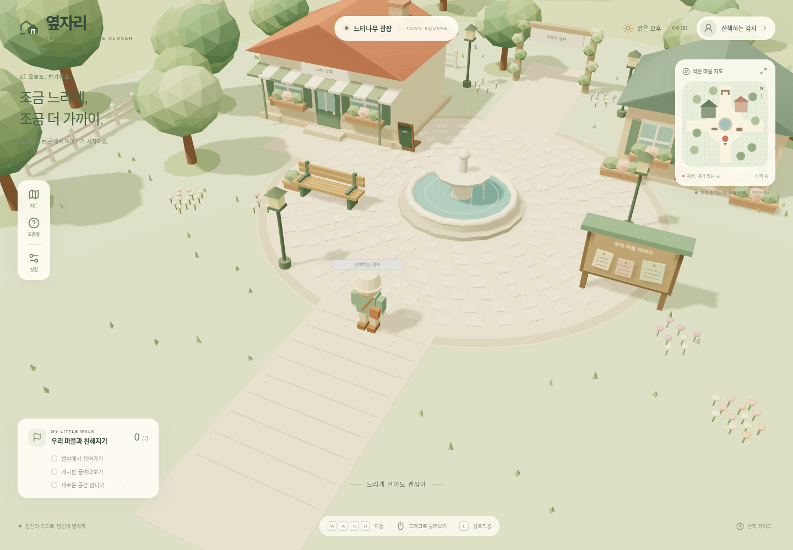

# 옆자리 · YEPJARI

가명으로 산책하는 작은 3D 소셜 웹게임의 첫 싱글플레이 버전입니다. Next.js App Router, TypeScript, React Three Fiber, Three.js로 구현했습니다. 그래픽은 코드로 제작한 원본 로우폴리 메시이며 외부 모델·이미지·폰트 CDN이 필요하지 않습니다.



[모바일 화면](docs/screenshots/mobile.png) · [실행 검증 기록](docs/VALIDATION.md) · [구현 구조](docs/ARCHITECTURE.md)

## 실행

Node.js 20.9 이상을 권장합니다.

```bash
npm ci
npm run dev
```

http://localhost:3000 에서 입장합니다. 프로덕션은 `npm run build` 후 `npm start`로 실행합니다. WebGL과 하드웨어 가속이 켜진 최신 Chrome, Edge, Firefox, Safari를 사용하세요.

## 조작

- PC: WASD / 방향키 이동, Shift 빠르게 걷기
- 마우스: 빈 화면 드래그로 시점 회전, 휠로 확대·축소
- 모바일: 왼쪽 가상 조이스틱 이동, 빈 화면 드래그로 시점 회전
- 상호작용: 오브젝트에 다가가 **E** 또는 화면 하단 버튼
- 벤치: 실제로 앉고 일어나기
- 게시판: 글 읽기·짧은 메모 남기기 (현재 브라우저에만 저장)
- 카페 문: 실내 입장, 출구 매트 근처에서 광장 복귀
- 광장 북쪽 아치: 정원 입장, 정원 남쪽 출구에서 광장 복귀
- 프로필: 가명 변경. 지도·도움말·설정 버튼으로 안내 열기. 설정에서 시작 위치 복귀

가명과 게시판 메모는 `localStorage`에 저장합니다. 다른 이용자와 공유되지 않으며 저장이 제한된 브라우저에서도 기본 플레이는 가능합니다. 대화상자를 열면 이동 입력을 멈춥니다. 실제 다른 플레이어나 온라인 인원 표시는 없습니다.

## 검사

```bash
npm run typecheck
npm test
npm run build
npm run test:e2e
```

브라우저 검사는 Playwright와 Chromium을 사용합니다. `/usr/bin/chromium`이 있으면 사용하고, 없으면 `npx playwright install chromium`으로 설치한 Playwright 브라우저를 사용합니다. `PLAYWRIGHT_CHROMIUM_PATH=/path/to/chromium npm run test:e2e`로 경로를 지정할 수도 있습니다. 개발 서버가 실행 중이면 재사용하고, 없으면 자동으로 띄웁니다. 테스트 결과·스크린샷은 `test-results/`에 생성됩니다. 실행 중인 프로덕션 서버를 검사하려면 `PLAYWRIGHT_BASE_URL=http://127.0.0.1:3001 npm run test:e2e`처럼 지정합니다.

## 구조

- `app/`: 페이지, 메타데이터, 반응형 스타일
- `components/game/Game.tsx`: 상호작용과 공간 전환 상태
- `components/game/GameCanvas.tsx`: WebGL 렌더러, 조명, 오류 복구 화면
- `components/game/Player.tsx`: 캐릭터 리그, 애니메이션, 입력, 카메라
- `components/game/World.tsx`, `Interiors.tsx`: 광장·카페·정원 원본 그래픽
- `components/game/GameUI.tsx`, `Joystick.tsx`: HUD, 지도, 게시판, 모바일 조작
- `lib/world.ts`: 공간별 충돌·스폰·근접 상호작용 데이터와 이동 판정
- `tests/`: 충돌·상호작용 단위 검사와 실제 브라우저 조작 검사
- `docs/`: 구현 범위와 실행 검증 기록

## 이번 단계의 한계

싱글플레이이며 서버·계정·실시간 동기화는 없습니다. 건물과 오브젝트는 평면 AABB 충돌을 사용하며 지형 높낮이, 점프, 정교한 물리 엔진은 없습니다. 책방은 배경 건물입니다. 실시간 멀티플레이, AI 호스트, 사용자 생성 마을·공간 꾸미기, 음성·영상, 서버 게시판은 후속 단계입니다.

참고 URL은 실행 환경의 네트워크 정책에서 접근이 차단되어 직접 조작하지 못했습니다. 참고 게임의 그래픽·에셋·소스는 가져오지 않았습니다.

## GitHub 검토

`work` 브랜치의 변경을 검토한 후 `main` 대상 Pull Request에서 병합할 수 있습니다. `main`을 강제로 전환하거나 초기화할 필요가 없습니다.
